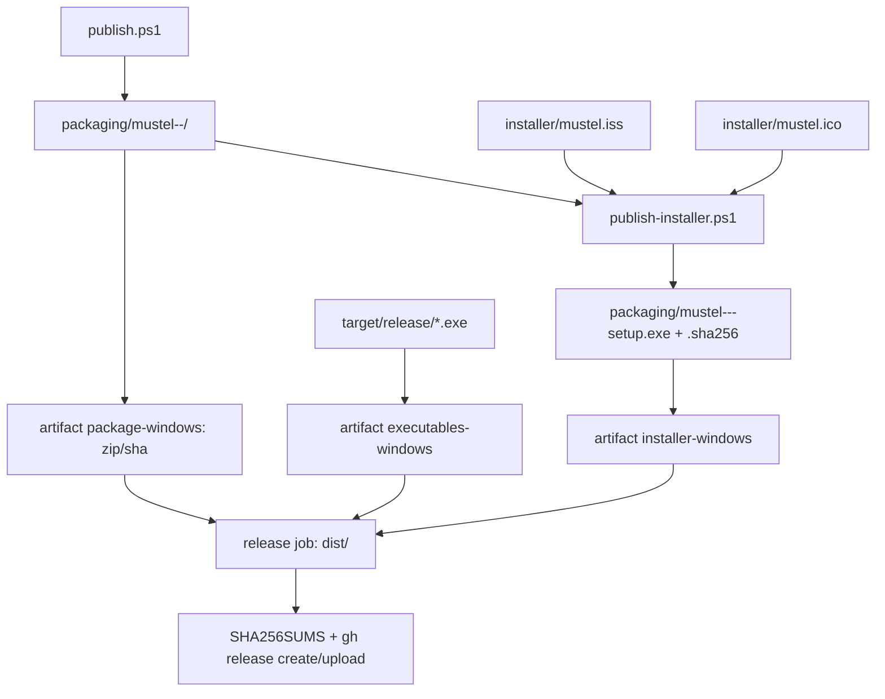

# Plano — Instalador do Windows (Inno Setup, por usuário)

> **Status:** em-andamento
> **Criado em:** 2026-11-07
> **Atualizado em:** 2026-11-07
> **Complexidade:** média
> **Depende de (outros planos):** nenhum (o updater está concluído e documentado em `docs/explanation/atualizacao.md`)

---

## 1. Visão Geral

Hoje o usuário Windows baixa o `.zip` da release, extrai e copia os `.exe` à mão. Não há atalho no
Menu Iniciar, entrada de desinstalação, opção de `PATH` nem lugar canônico de instalação. A partir da
**1.1.0** o app também tem atualização automática, que troca os **dois** `.exe` lado a lado — o que só
funciona bem quando a pasta é gravável pelo usuário.

O instalador resolve a primeira instalação (e o reparo manual) com um único `.exe`: instala
`mustel.exe` e `mustel-gui.exe` **só para o usuário atual**, sem UAC, em
`%LOCALAPPDATA%\Programs\Mustel`; cria atalho no Menu Iniciar (`mustel-gui.exe`), entrada de
desinstalação e a tarefa opcional de `PATH`; mostra a licença AGPL e os avisos; e **não toca** em
configuração, logs, estado do updater nem credenciais. O updater continua sendo o caminho de
atualização — o instalador é distribuição, não um segundo mecanismo de update.

> A **1.0.0 publicada não tem** updater nem instalador; quem está nela atualiza uma vez à mão. O
> instalador entra na **1.1.0**, a mesma release que introduz o updater.

---

## 2. Escopo

**Inclui:**

- Instalador **Inno Setup 6** gerado no job Windows do release, a partir do stage do `publish.ps1`.
- Instalação **por usuário**, sem administrador, em `%LOCALAPPDATA%\Programs\Mustel`.
- Os **dois** executáveis lado a lado (`mustel.exe` e `mustel-gui.exe`), mais exemplo de config,
  licença, avisos, SBOM e README do pacote.
- Atalho no **Menu Iniciar** para `mustel-gui.exe`; atalho opcional na Área de Trabalho.
- Tarefa opcional **`Add Mustel to PATH`** (`HKCU\Environment\Path`, sem duplicar, removida no
  desinstalador), marcada por padrão só na primeira instalação.
- Página de licença (AGPL-3.0-only) e entrada de desinstalação.
- Desinstalador que remove arquivos, atalhos, `PATH` e a entrada de desinstalação, **preservando**
  `%APPDATA%\Mustel`, `%LOCALAPPDATA%\Mustel` (logs e `update.json`) e o Credential Manager.
- Instalação **silenciosa** documentada (`/VERYSILENT /SUPPRESSMSGBOXES /NORESTART /SP-`).
- Integração no `publish.yml` (job Windows), no `SHA256SUMS` e na página de release; o setup é um
  asset adicional e **não** é consumido pelo updater.
- Documentação (how-to, referência, explicação, README, decisão `D31`).

**Exclui explicitamente:**

- Assinatura de código / EV certificate / remoção do aviso do SmartScreen. O instalador sai
  **não assinado**, como os `.exe` de hoje; documentar o aviso.
- MSIX, Microsoft Store, `winget` (o projeto decidiu não publicar no winget — `D17`/`D22`).
- Instalação por máquina em `Program Files` (quebraria a atualização in-place do updater em pasta
  somente leitura; ver `D2`).
- Atualização automática **pelo instalador**: o updater baixa os `.exe` crus; o setup é para
  primeira instalação e reparo manual.
- Embutir `VERSIONINFO`/ícone nos `.exe` Rust nesta entrega (o atalho usa `mustel.ico`; o ícone da
  janela continua embutido em runtime). Registrar como follow-up.
- Instaladores para Linux/macOS, serviço do Windows, tarefa agendada, associação de arquivos.
- Remoção de dados do usuário no desinstalador.
- Alterações no `cargo install` ou no canal do crates.io.

---

## 3. Decisões

Decisões propostas na exploração. O agente **não reabre** sem justificativa e aprovação do dono.

| # | Decisão | Escolha | Razão |
|---|---------|---------|-------|
| D1 | Ferramenta do instalador | **Inno Setup 6.7.1** no release (pré-instalado no `windows-latest`); **6.7.4/7.1.1** apenas no teste local via Wine | Gera um `.exe` único, suporta instalação por usuário, atalhos, `PATH`, licença, idiomas, instalação silenciosa e desinstalador; é fácil de rodar no `windows-latest`. **Não** há build nativo no Linux; o `ISCC.exe` é um binário Windows. **Wine em container funciona para teste local** (harness `installer/wine-test`, provado com 6.7.4 e 7.1.1 x86), mas não é caminho suportado nem gate. O Mustel é open source sem fins lucrativos e a JRSoftware não solicita licença do Inno Setup para uso não comercial; a licença também permite uso comercial (compra solicitada, não exigida). O 6.7.1 do runner é o usado no release. WiX/MSI e MSIX são mais pesados e/ou exigem assinatura/identidade; NSIS dá mais trabalho para o mesmo resultado. |
| D2 | Escopo da instalação | **Por usuário**, sem UAC | `%LOCALAPPDATA%\Programs\Mustel` é gravável; o updater troca os dois `.exe` no lugar. Em `Program Files` o updater cairia no fallback `<state>/Mustel/updates/<versão>` e pediria instalação manual. |
| D3 | Executáveis instalados | **Os dois**, lado a lado | O updater no Windows atualiza `mustel.exe` **e** `mustel-gui.exe` quando estão juntos; o atalho usa o `mustel-gui.exe` (sem console) e o `mustel.exe` é o CLI. |
| D4 | Atalho principal | **Menu Iniciar → `mustel-gui.exe`** | Abre a janela sem console. Não criar atalho de terminal: o `mustel.exe` sem subcomando já abre a janela em terminal, mas um atalho de console pisca uma janela antes. |
| D5 | `PATH` | Tarefa opcional, **marcada na primeira instalação** | `HKCU\Environment\Path` não exige admin e torna o CLI `mustel` utilizável. O desinstalador remove **só** a entrada do Mustel e não duplica; quem usa `cargo install` pode desmarcar. |
| D6 | Dados do usuário | **Preservar** no desinstalador | Config (`%APPDATA%\Mustel\mustel.jsonc`), logs/estado (`%LOCALAPPDATA%\Mustel`), `update.json` e Credential Manager não pertencem ao instalador. O desinstalador remove só `{app}`, atalhos, `PATH` e a entrada de desinstalação. |
| D7 | De onde vêm os arquivos | **Stage do `publish.ps1`** (`packaging\mustel-<versão>-<triple>\`) | Uma única compilação/empacotamento; o instalador não recompila nem duplica a lista de arquivos do pacote. |
| D8 | Script do instalador | **Separado**: `installer\publish-installer.ps1` | O `publish.ps1` continua gerando o `.zip` sem exigir Inno Setup; o CI chama os dois. |
| D9 | Versão e nome | Derivar de `cargo pkgid -p mustel`; saída `mustel-<versão>-<triple>-setup.exe` | Fonte única da versão (1.1.0 agora); o `.sha256` acompanha, no mesmo padrão dos pacotes. |
| D10 | Asset da release | O setup é **asset adicional**; `SHA256SUMS` já cobre `.exe` | O job de release faz `sha256sum ./*.exe`; o setup entra automaticamente. O updater só procura `mustel.exe`/`mustel-gui.exe` e **ignora** o setup. |
| D11 | Assinatura e canais | **Sem assinatura nesta entrega**; sem winget/MSIX/Store | Não há certificado hoje; o SmartScreen pode avisar. O caminho para assinar depois está em 8.1 (SignPath OSS/Azure Trusted Signing/OV/EV; autoassinado não serve para release). O winget está fora por decisão do dono (`D17`/`D22`). |
| D12 | App em execução no upgrade | `CloseApplications=yes`, `RestartApplications=no` | Inno usa o Restart Manager para fechar `mustel.exe`/`mustel-gui.exe` antes de substituir; o usuário reabre pelo atalho/`Run`. |
| D13 | Instalação silenciosa | Suportar `/VERYSILENT /SUPPRESSMSGBOXES /NORESTART /SP-` | Necessário para smoke/CI e instalação corporativa; documentar os códigos de saída. |
| D14 | Configuração | **Não** criar/alterar `mustel.jsonc` | O app lê defaults quando o arquivo não existe; criar um config na instalação poderia sobrescrever o do usuário e divergir do exemplo. O `mustel.example.jsonc` vai para `{app}` como referência. |
| D15 | Ícone | `installer\mustel.ico` (multi-tamanho), usado no setup, nos atalhos e no `UninstallDisplayIcon`; copiado para `{app}` | Dá ícone correto ao instalador e aos atalhos sem exigir recurso embutido nos `.exe` nesta entrega. |
| D16 | Publisher/URLs | `MustelGuild`, `https://github.com/MustelGuild/Mustel`, suporte `support@mustelguild.dev`, updates em `.../releases/latest` | Consistente com o repositório, o About e o canal de release (`D17`). |
| D17 | Identidade de upgrade | `AppId` **GUID fixo**, escolhido uma vez e nunca alterado | Inno usa o `AppId` para detectar instalação anterior/upgrade e para o desinstalador; mudar quebra upgrades. |
| D18 | Plataforma | **Windows 10+ x64**; `ArchitecturesAllowed=x64compatible` | Os binários publicados são `x86_64-pc-windows-msvc`; o projeto não publica ARM64. |
| D19 | Integração CI | Job `package` Windows roda `publish.ps1` → `publish-installer.ps1`; artefato **`installer-windows`** separado; **somente `windows-latest`**, sem Wine/Linux | Mantém o artefato do `.zip` intacto e deixa o setup explícito; o job de release baixa todos e o setup chega a `dist/`. O Inno Setup já vem no runner (6.7.1) e não há build de instalador no job Linux. |
| D20 | Documentação e decisão | Nova how-to/referência, seção na explicação do updater, README, `D31` em `decisoes.md` | O instalador muda o caminho de instalação do Windows; a decisão e os caminhos precisam ficar registrados e linkados em `docs/README.md`. |
| D21 | Idiomas do instalador | **Inglês + português do Brasil**, seguindo o idioma do Windows | O binário fala inglês; o instalador pode acolher o dono e usuários pt-BR sem alterar o contrato do CLI. Confirmado pelo dono (Q3). |
| D22 | Licença | Página de licença com o `LICENSE` do stage (AGPL-3.0-only) | O instalador deve exigir aceite; os textos de terceiros viajam em `THIRD-PARTY-LICENSES.md`. |
| D23 | Canal Windows | **Setup recomendado + `.zip` mantido** | O zip continua para quem prefere portátil e é o formato que o updater já consome (os `.exe` crus); o setup é aditivo, não substitui o canal. Confirmado pelo dono (Q9). |
| D24 | Teste do instalador no Linux | `installer/wine-test/` (Ubuntu 24.04 + Wine 9 + Inno Setup 6.7.4 x86 por padrão; 7.1.1 via `INNO_URL`) | Provado: o `ISCC` compila o `smoke.iss` **e o `.iss` real** (`real.sh`), o setup instala/desinstala sob Wine, sem desktop (Xvfb). É **teste local, não gate**; o release continua no `windows-latest`. O Wine win32 não cria `.lnk` nem removeu o PATH; os dois ficam para o T8 Windows. Uso não comercial é gratuito (a JRSoftware não solicita licença); uso comercial tem compra solicitada, não exigida. |

---

## 4. Arquitetura / Design

### Comparação das opções

| Opção | Prós | Contras | Veredito |
|---|---|---|---|
| **Inno Setup 6** | `.exe` único, por usuário, atalhos, `PATH`, licença, idiomas, silencioso, desinstalador; script simples | Só Windows; UI um pouco datada; precisa do `ISCC.exe` no runner | **Escolhido** |
| WiX / MSI | Padrão corporativo, MSI, GPO | Per-user em MSI é trabalhoso; padrão admin/`Program Files`; integração com o updater pior; mais curva | Não |
| MSIX / Store | Identidade de app, atualização gerenciada | Exige assinatura/identidade e conflita com o updater in-app; publicação na Store | Não |
| NSIS | Pequeno, scriptável | Mais script manual para licença/idiomas/PATH; UI antiga | Não |

> **Inno Setup é Windows-only.** Não existe build nativo para Linux; o `ISCC.exe` é um binário
> Windows (Wine não é caminho suportado). O `windows-latest` já traz o Inno Setup **6.7.1**, e o
> build fica **só** nele (Q1/Q14); não há passo de instalador no job Linux.

### Fluxo de build e release



### Fluxo na máquina do usuário

```text
setup.exe (por usuário, sem UAC)
   │
   ├── %LOCALAPPDATA%\Programs\Mustel\
   │      mustel.exe
   │      mustel-gui.exe
   │      mustel.ico
   │      mustel.example.jsonc
   │      LICENSE / THIRD-PARTY-NOTICES.md / THIRD-PARTY-LICENSES.md
   │      sbom.cdx.json / README.txt
   ├── Menu Iniciar\Mustel → mustel-gui.exe
   ├── (opcional) Área de Trabalho\Mustel → mustel-gui.exe
   ├── (opcional) HKCU\Environment\Path += {app}
   └── HKCU\...\Uninstall\Mustel → unins000.exe

Atualização (updater 1.1.0+)
   API GitHub → baixa mustel.exe/mustel-gui.exe crus → helper troca os dois na MESMA pasta
   → relança → toast "Updated to X"
```

### Onde ficam os dados (o instalador não toca)

| Dado | Caminho |
|---|---|
| Instalação (este plano) | `%LOCALAPPDATA%\Programs\Mustel` |
| Configuração | `%APPDATA%\Mustel\mustel.jsonc` |
| Logs e estado do updater | `%LOCALAPPDATA%\Mustel` (`logs/`, `update.json`) |
| Credenciais | Credential Manager, serviço do Mustel |
| Relatórios | `%LOCALAPPDATA%\Mustel\reports` (quando a aba Activity salva) |

O desinstalador remove apenas `{app}`, atalhos, a entrada de `PATH` e a entrada de desinstalação.
Nada de `%APPDATA%\Mustel`, `%LOCALAPPDATA%\Mustel` ou Credential Manager.

### Arquivos novos

- `installer/mustel.iss` — script do Inno Setup com `[Setup]`, `[Files]`, `[Icons]`, `[Tasks]`,
  `[Run]`, `[Code]` (PATH) e `[UninstallDelete]`.
- `installer/mustel.ico` — ícone multi-tamanho derivado de `crates/mustel-gui/assets/icon.png`.
- `installer/publish-installer.ps1` — descobre versão/triple/stage, acha o `ISCC.exe`, compila com
  `/DMyAppVersion`, `/DMyAppStage`, `/DMyArch`, `/DMyOutputDir`; confere a saída e grava o `.sha256`.
- `installer/wine-test/` — ambiente de teste Linux: `Dockerfile` (Ubuntu 24.04 + Wine 9 + Inno
  Setup 6.7.4 x86), `run.sh` (host: build + container), `inside.sh` (ISCC + setup silencioso),
  `smoke.iss`/`dummy.txt` (teste sintético), `real.sh`/`real-inside.sh` (instalador real) e
  `README.md` (licença, 7.1.1 opcional, limitações do Wine, limpeza).

### Mudanças em arquivos existentes

- `.github/workflows/publish.yml` — passo Windows `publish-installer.ps1` + artefato
  `installer-windows`; o job de release baixa tudo e o `sha256sum ./*.exe` já inclui o setup.
- `README.md` / `README.pt-BR.md` — instalação Windows recomendada via setup; `.zip` como
  alternativa; `cargo install` inalterado.
- `docs/how-to/publicar-release.md` — passo do instalador, asset na release e no `SHA256SUMS`.
- `docs/reference/updates.md` — nota: o setup não é payload do updater; os `.exe` crus são.
- `docs/explanation/atualizacao.md` — seção "Por que o instalador é por usuário" (updater in-place
  vs fallback em pasta somente leitura).
- `docs/explanation/decisoes.md` — `D31` com a escolha.
- `docs/README.md` — links da how-to/referência.
- `AGENTS.md` — mencionar `installer/` e `publish-installer.ps1` na seção de release/estrutura.

### Chaves do `.iss`

- `[Setup]`: `AppId` fixo; `AppName=Mustel`; `AppVersion={#MyAppVersion}`;
  `AppVerName=Mustel {#MyAppVersion}`; `AppPublisher=MustelGuild`; `AppPublisherURL`,
  `AppSupportURL`, `AppUpdatesURL`; `DefaultDirName={autopf}\Mustel`;
  `PrivilegesRequired=lowest`; `DefaultGroupName=Mustel`; `DisableProgramGroupPage=yes`;
  `LicenseFile={#MyAppStage}\LICENSE`; `OutputDir={#MyOutputDir}`;
  `OutputBaseFilename=mustel-{#MyAppVersion}-{#MyArch}-setup`; `SetupIconFile=mustel.ico`;
  `UninstallDisplayIcon={app}\mustel.ico`; `UninstallDisplayName=Mustel`;
  `Compression=lzma2/ultra64`; `SolidCompression=yes`; `WizardStyle=modern`;
  `ArchitecturesAllowed=x64compatible`; `ArchitecturesInstallIn64BitMode=x64compatible`;
  `MinVersion=10.0`; `CloseApplications=yes`; `RestartApplications=no`;
  `ChangesEnvironment=yes`; `UsePreviousAppDir=yes`; `UsePreviousTasks=yes`;
  `VersionInfoVersion={#MyAppVersion4}`; `VersionInfoProductVersion={#MyAppVersion}`;
  `VersionInfoCompany=MustelGuild`; `VersionInfoDescription=Mustel installer`;
  `VersionInfoProductName=Mustel`; `VersionInfoCopyright=AGPL-3.0-only`.
- `[Files]`: `{#MyAppStage}\*` → `{app}` com `ignoreversion recursesubdirs createallsubdirs`;
  `mustel.ico` → `{app}`.
- `[Icons]`: Menu Iniciar `Mustel` → `{app}\mustel-gui.exe`, `WorkingDir={app}`,
  `IconFilename={app}\mustel.ico`; desinstalador; atalho opcional em `{autodesktop}` com
  `Tasks: desktopicon`.
- `[Tasks]`: `desktopicon` (desmarcada) e `addtopath` (`checkedonce`).
- `[Run]`: `{app}\mustel-gui.exe` com `nowait postinstall skipifsilent`.
- `[Code]`: `AddToPath`/`RemoveFromPath` em `HKCU\Environment\Path` (preserva o valor existente,
  não duplica, remove só `{app}`); `CurStepChanged(ssPostInstall)` e
  `CurUninstallStepChanged(usPostUninstall)`.
- `[UninstallDelete]`: `{app}\*.old`, `{app}\.mustel-update-*`, `{app}\.mustel-helper-*` (restos do
  updater; nada de dados do usuário).

---

## 5. Tarefas

### Fase 1 — Instalador

- [x] **T1** — Gerar `installer/mustel.ico` multi-tamanho a partir de
      `crates/mustel-gui/assets/icon.png` (256, 128, 64, 48, 32, 16) e conferir com `file`/ImageMagick.
  - Depende de: —
  - Paralelizável com: —
  - Concluído quando: `magick crates/mustel-gui/assets/icon.png -define icon:auto-resize=256,128,64,48,32,16 installer/mustel.ico` (ou `convert`) gera o arquivo; `file installer/mustel.ico` o reconhece como ícone do Windows com os tamanhos.
  - Arquivos: `installer/mustel.ico`

- [x] **T2** — Escrever `installer/mustel.iss` com as decisões D1–D22: por usuário, ambos os `.exe`,
      atalhos, `PATH` opcional, licença, desinstalação, `CloseApplications`, silencioso e
      `AppId` fixo.
  - Depende de: T1
  - Paralelizável com: —
  - Concluído quando: `ISCC.exe` compila o `.iss` no Windows sem erro; o setup abre com a licença,
    o diretório `%LOCALAPPDATA%\Programs\Mustel`, o atalho e a tarefa de `PATH`; o `AppId` é um
    GUID v4 fixo, gerado uma vez e documentado no próprio `.iss`.
  - Arquivos: `installer/mustel.iss`

- [x] **T3** — Escrever `installer/publish-installer.ps1`: derivar versão/triple, garantir o stage
      (rodando `publish.ps1` se faltar), achar o `ISCC.exe`, compilar com os defines, validar a
      saída e gravar o `.sha256`.
  - Depende de: T2
  - Paralelizável com: —
  - Concluído quando: o script produz `packaging/mustel-<versão>-<triple>-setup.exe` e o `.sha256`,
    imprime o caminho e sai 0; sem Inno Setup, falha com mensagem acionável.
  - Arquivos: `installer/publish-installer.ps1`

- [x] **T4** — Criar o harness de teste no Linux `installer/wine-test/`: Dockerfile (Ubuntu 24.04
      + Wine 9 + Inno Setup 6.7.4 x86; 7.1.1 via `INNO_URL`), `run.sh`, `inside.sh`, `smoke.iss`,
      `dummy.txt`, `real.sh`/`real-inside.sh` (instalador real) e README. Compila o `.iss` e instala
      o setup sob Wine com Xvfb, sem desktop.
  - Depende de: —
  - Paralelizável com: T1, T2
  - Concluído quando: `sh installer/wine-test/run.sh` sai 0, gera
    `target/wine-test/wine-test-setup.exe` (PE32) e o marcador `C:\WineTest\dummy.txt` existe no
    prefixo Wine; `sh installer/wine-test/real.sh target/installer-stage` compila o `.iss` real,
    instala, confere dados e desinstala (os avisos de `.lnk`/`PATH` no Wine ficam para o T8).
  - Arquivos: `installer/wine-test/Dockerfile`, `installer/wine-test/run.sh`,
    `installer/wine-test/inside.sh`, `installer/wine-test/smoke.iss`,
    `installer/wine-test/dummy.txt`, `installer/wine-test/real.sh`,
    `installer/wine-test/real-inside.sh`, `installer/wine-test/README.md`

### Fase 2 — Release e documentação

- [x] **T5** — Integrar no `.github/workflows/publish.yml`: no job Windows, rodar
      `publish-installer.ps1` depois do `publish.ps1`; publicar o artefato `installer-windows`
      (`packaging/*-setup.exe`); garantir que o job de release o leve a `dist/` e que o
      `SHA256SUMS` (`./*.exe`) o inclua. O build é **somente no `windows-latest`** (Inno Setup
      6.7.1 pré-instalado); nenhum passo de Wine/Linux (Q1/Q14).
  - Depende de: T3
  - Paralelizável com: T6, T7
  - Concluído quando: `actionlint` passa; o job Windows produz o setup; a release baixa o artefato;
    o `SHA256SUMS` contém `./mustel-<versão>-<triple>-setup.exe`; o job Linux **não** tenta
    construir o setup.
  - Arquivos: `.github/workflows/publish.yml`

- [x] **T6** — Documentação: README/README.pt-BR (setup recomendado, zip alternativa), nova
      `docs/how-to/instalar-no-windows.md`, nova `docs/reference/instalador-windows.md`, seção em
      `docs/explanation/atualizacao.md`, nota em `docs/reference/updates.md`, assets em
      `docs/how-to/publicar-release.md`, links em `docs/README.md` e `AGENTS.md`.
  - Depende de: T2, T5
  - Paralelizável com: T7
  - Concluído quando: `documentation_links_resolve` verde; a how-to e a referência descrevem
    caminhos, silencioso, desinstalação e preservação de dados; o README aponta o setup.
  - Arquivos: `README.md`, `README.pt-BR.md`, `docs/how-to/instalar-no-windows.md`,
    `docs/reference/instalador-windows.md`, `docs/explanation/atualizacao.md`,
    `docs/reference/updates.md`, `docs/how-to/publicar-release.md`, `docs/README.md`, `AGENTS.md`

- [x] **T7** — Registrar a decisão `D31` em `docs/explanation/decisoes.md`: Inno Setup 6, por
      usuário, dois `.exe`, atalho para `mustel-gui.exe`, `PATH` opcional, dados preservados;
      sem winget/MSIX/assinatura nesta entrega.
  - Depende de: T2
  - Paralelizável com: T6
  - Concluído quando: a linha `D31` existe, está coerente com o `.iss` e é referenciada pela
    documentação.
  - Arquivos: `docs/explanation/decisoes.md`

### Fase 3 — Verificação

- [ ] **T8** — Validar no Windows de verdade: `publish.ps1` → `publish-installer.ps1`; instalar pelo
      wizard (sem UAC); conferir Menu Iniciar, `PATH`, `mustel --version`, GUI, config/logs;
      desinstalar; reinstalar/upgrade; conferir dados preservados.
  - Depende de: T3
  - Paralelizável com: T10
  - Concluído quando: o checklist da seção 6 passa inteiro na máquina do dono.
  - Arquivos: —

- [ ] **T9** — Validar a convivência com o updater: instalar 1.1.0 pelo setup, abrir a janela,
      apontar `MUSTEL_UPDATE_API` para uma release falsa (debug) ou usar a release seguinte e
      conferir que **os dois** `.exe` são trocados na pasta do instalador, o helper relança e o
      toast `Updated to …` aparece; conferir que o setup extra na release é ignorado.
  - Depende de: T8
  - Paralelizável com: T10
  - Concluído quando: o update in-place funciona na pasta por usuário, sem UAC e sem fallback; o
    setup não é escolhido como payload.
  - Arquivos: —

- [ ] **T10** — Validar o release: rodar o QA Gate, disparar o `publish` de ensaio/real com a tag
      (quando o dono autorizar), conferir o setup e o `SHA256SUMS` na release e os links da doc.
  - Depende de: T5
  - Paralelizável com: T8, T9
  - Concluído quando: o setup está na release, o hash confere, os assets antigos continuam e o
    updater de uma instalação anterior continua achando os `.exe` crus.
  - Arquivos: —

- [ ] **T11** — Limpeza: remover instalações de teste, `packaging/` temporário, capturas e
      diretórios `%TEMP%` do smoke; não apagar dados reais.
  - Depende de: T8, T9, T10
  - Paralelizável com: —
  - Concluído quando: não sobram artefatos de teste no repositório nem na máquina.
  - Arquivos: —

---

## 6. Estratégia de Verificação

- **Lint do workflow:** `target/actionlint/actionlint .github/workflows/publish.yml` — exit 0.
- **Plataforma do build:** o setup do release é compilado **só** no `windows-latest` (Inno Setup
  6.7.1 pré-instalado); o harness local via Wine é ferramenta de teste, não build de release
  (Q1/Q14).
- **Teste local do instalador (container, não gate):** `sh installer/wine-test/run.sh` — constrói
  a imagem (Ubuntu 24.04 + Wine 9 + Inno Setup 6.7.4 x86), compila `smoke.iss` e instala o setup
  sob Wine, sem desktop. Para testar o 7.1.1 x86: `INNO_URL=... sh installer/wine-test/run.sh`
  (uso não comercial é gratuito; compra só solicitada no uso comercial). O `.iss`/stage reais (T2/T3) podem ser montados no container; isso não
  substitui o smoke Windows (SmartScreen, Explorer/Menu Iniciar reais, Credential Manager, locks e
  updater/helper).
- **Instalador real no container (não gate):** `sh installer/wine-test/real.sh <stage>` compila o
  `installer/mustel.iss`, instala e desinstala. O Wine win32 **não cria `.lnk`** e **não removeu a
  entrada de `PATH`** no desinstalador; essas duas validações ficam para o T8 Windows. Arquivos,
  `PATH` adicionado, dados preservados e `.old` removido passaram.
- **Rust (não deve haver mudança de código, mas o gate roda):**
  - `cargo fmt --all --check`
  - `cargo clippy --workspace --all-targets --all-features -- -D warnings`
  - `cargo test -p mustel --test contract_manifest`
  - `cargo test -p mustel-core --test contract_decisions` (links)
  - `cargo test --workspace --no-fail-fast` — no Linux, só os 2 alvos conhecidos
    (`cli_tree`/`contract_replay`) podem falhar.
- **Conteúdo do `.iss`:** `grep` deve achar `PrivilegesRequired=lowest`,
  `DefaultDirName={autopf}\Mustel`, `CloseApplications=yes`, `ChangesEnvironment=yes`,
  `ArchitecturesAllowed=x64compatible`, `MinVersion=10.0`; e **não** deve haver `Program Files`,
  `PrivilegesRequired=admin`, `winget` nem `MSIX`.
- **Windows — instalação/desinstalação:**
  1. `./publish.ps1` e `./installer/publish-installer.ps1`.
  2. Conferir `packaging\mustel-1.1.0-x86_64-pc-windows-msvc-setup.exe` e o `.sha256`
     (`Get-FileHash`).
  3. Instalar pelo wizard; **não** deve pedir UAC. Conferir
     `%LOCALAPPDATA%\Programs\Mustel\mustel.exe` e `mustel-gui.exe`, o Menu Iniciar, o atalho
     opcional e o `PATH` (se marcado).
  4. Rodar `mustel --version` (deve dizer `mustel 1.1.0`) e abrir `mustel-gui.exe`.
  5. Desinstalar; conferir que `{app}`, atalhos, `PATH` e a entrada de desinstalação sumiram, e que
     `%APPDATA%\Mustel`, `%LOCALAPPDATA%\Mustel` e as credenciais **continuam**.
  6. Reinstalar sobre a 1.1.0 (upgrade) com a GUI aberta: o Inno deve fechar e trocar os arquivos,
     sem duplicar `PATH`.
  7. Instalação silenciosa:
     `.\packaging\mustel-1.1.0-x86_64-pc-windows-msvc-setup.exe /VERYSILENT /SUPPRESSMSGBOXES /NORESTART /SP-`
     e desinstalação `/VERYSILENT`; exit 0.
- **Windows — updater:** instalar 1.1.0; com `MUSTEL_UPDATE_API` (debug) apontando para a release
  falsa, conferir o toast `Mustel X is available`, o `Update`, a troca dos **dois** `.exe`, o
  `.old`, o relançamento e o toast `Updated to …`; confirmar que o setup `.exe` da release **não**
  foi escolhido como payload.
- **Release:** no `publish` (quando o dono autorizar), conferir o asset `*-setup.exe`, a linha
  `./mustel-...-setup.exe` no `SHA256SUMS`, e que `mustel.exe`/`mustel-gui.exe` crus continuam
  presentes para o updater.
- **Docs:** `documentation_links_resolve` verde; `grep -ri winget` nos arquivos do instalador e
  docs novos retorna zero.
- **Assinatura:** o setup sai não assinado; registrar no README/referência que o SmartScreen pode
  avisar. Não é falha do plano.

> O agente só marca o plano como `concluído` após **todas** as verificações acima passarem. A
> validação Windows é do dono (o agente Linux não abre a janela/instalador).

---

## 7. Riscos e Mitigação

| Risco | Prob | Impacto | Mitigação |
|---|---|---|---|
| `ISCC.exe` ausente ou versão diferente no `windows-latest` | média | alto | Conferir no runner; se faltar, instalar Inno Setup 6 com versão pinada via Chocolatey; falhar cedo com mensagem clara |
| Instalação em pasta somente leitura (usuário escolhe `Program Files` ou perfil corporativo) | baixa | alto | Não oferecer per-machine; documentar que o updater precisa de pasta gravável e cai no fallback se não for |
| SmartScreen/antivírus bloqueiam o setup não assinado | alta | médio | Documentar; assinatura de código é follow-up; o `.zip` continua como alternativa |
| `PATH` corrompido/duplicado | média | médio | Escrever só `HKCU\Environment\Path`, preservar o valor, checar duplicata, remover no uninstall; testar com `PATH` vazio e com espaços |
| Upgrade com app em execução | média | médio | `CloseApplications=yes`; testar com `mustel.exe` e `mustel-gui.exe` abertos |
| Desinstalador apagar dados do usuário | baixa | alto | Não incluir `%APPDATA%`/`%LOCALAPPDATA%`/Keyring nas listas; testar |
| Setup `.exe` confundir o updater | baixa | alto | O updater só procura `mustel.exe`/`mustel-gui.exe`; teste T9; manter o `SHA256SUMS` com o setup |
| Versão do setup divergir da versão do app | baixa | médio | Derivar de `cargo pkgid`; o stage é a fonte; falhar se o stage não casar |
| Artefato do setup não chegar ao `dist`/release | baixa | médio | `installer-windows` + `download-artifact merge-multiple`; `actionlint`; conferir `dist` no job |
| Ícone genérico no Explorer (recurso do `.exe`) | média | baixo | O atalho usa `mustel.ico`; embutir `VERSIONINFO`/ícone nos `.exe` fica como follow-up |
| Idioma do instalador não agradar | baixa | baixo | Inglês + pt-BR com escolha pelo idioma do Windows; Q3 |
| `winget` ser esperado | baixa | médio | Fora de escopo por `D17`/`D22`; documentar os canais |
| Usuário da 1.0.0 não ter updater/instalador | média | médio | Documentar a atualização manual única; o 1.1.0 é a estreia do instalador/updater |
| Wine win32 não cria `.lnk` / não remove o `PATH` no desinstalador | alta (Wine) | baixo | São limitações do prefixo, não do `.iss`; T8 valida atalho e remoção do `PATH` no Windows x64 |

---

## 8. Questões em Aberto

Nenhuma bloqueante. As respostas do dono (2026-11-07) fecharam o escopo:

| # | Resposta | Efeito |
|---|---|---|
| Q1 | Inno Setup é **Windows-only**; o `windows-latest` traz **6.7.1**, e o **6.7.4/7.1.1** também são Windows-only. Não há build nativo no Linux; o **harness `installer/wine-test`** prova o `ISCC` + setup sob Wine (6.7.4 padrão; 7.1.1 opcional). O release fica no `windows-latest`. | D1, D19, D24, T5, verificação |
| Q2 | Instalação **por usuário**. | D2 |
| Q3 | **Os dois idiomas**, seguindo o idioma do Windows. | D21 |
| Q4 | `PATH` marcado por padrão na primeira instalação. | D5 |
| Q5 | Atalho da Área de Trabalho desmarcado por padrão. | T2 |
| Q6 | Desinstalador **preserva** os dados. | D6 |
| Q7 | Ícone/`VERSIONINFO` nos `.exe` fica como follow-up; o setup/atalhos usam `mustel.ico`. | D15 |
| Q8 | Sem certificado agora; o guia de assinatura está em 8.1 e fica como follow-up. | D11 |
| Q9 | Manter o `.zip` como alternativa. | D23 |
| Q10 | **Não** criar `mustel.jsonc`; só instalar o exemplo. | D14 |
| Q11 | **Sem** atalho de terminal. | D4 |
| Q12 | Windows 10+ x64; nome `mustel-<versão>-<x86_64-pc-windows-msvc>-setup.exe`. | D18 |
| Q13 | Instalador no job Windows, artefato `installer-windows` separado, setup no `SHA256SUMS`. | D19 |
| Q14 | **Só** no `windows-latest` para o **release**; o harness local via Wine é teste (D24). | D19, T5 |

### 8.1 Assinatura de código (follow-up, fora deste plano)

O setup e os `.exe` saem **não assinados** nesta entrega. Para assinar no futuro:

- **Autoassinado** (`New-SelfSignedCertificate`/OpenSSL): serve só para teste; o Windows/SmartScreen
  de outra máquina não confia — **não** é opção para release.
- **OV (Organization Validation)** ou **EV (Extended Validation)** de uma CA (DigiCert, Sectigo,
  Certum, SSL.com, …): exige verificação de identidade e chave em token/HSM FIPS 140-2 nível 2
  (desde 2023). O EV costuma dar reputação imediata no SmartScreen; o OV ganha reputação com o uso.
- **Azure Trusted Signing** (Microsoft): assinatura em nuvem, com validação de identidade e
  integração com GitHub Actions/OIDC; não usa token físico.
- **SignPath Foundation** (open source) ou **Certum Open Source**: opções voltadas a projetos OSS;
  o Mustel é AGPL-3.0-only e pode se qualificar — vale aplicar.

Passos gerais: escolher o provedor e a elegibilidade → verificar identidade/empresa → obter
certificado/token ou conta de assinatura → assinar com `signtool sign /fd SHA256 /tr <timestamp RFC
3161> /td SHA256 /a <arquivo>` (ou a action do provedor) → conferir com `signtool verify /pa /v` /
`Get-AuthenticodeSignature` → assinar os **dois `.exe` e o setup** antes de gravar o `SHA256SUMS`.
O timestamp mantém a assinatura válida depois de o certificado expirar. No CI, a chave nunca entra
no repositório: usa-se secret/OIDC/token do provedor.

---

## 9. Log de Execução

Append-only. O agente registra cada avanço relevante.

- `[2026-11-07]` Plano criado a partir da exploração do release atual (`publish.yml`,
  `publish.ps1`, `publish.sh`), do stage do pacote, do updater (`update.json`, fallback) e dos
  caminhos de dados do Windows. Decisões D1–D23 propostas; nenhuma implementação iniciada.
- `[2026-11-07]` Q1–Q14 respondidas pelo dono: Inno Setup é Windows-only (o `windows-latest` traz
  **6.7.1**; sem build de release Linux/Wine), per-user, dois idiomas seguindo o Windows, `PATH`
  on, desktop off, dados preservados, ícone/`VERSIONINFO` como follow-up, sem certificado agora,
  zip mantido, sem config automática, sem atalho de terminal, Win10+ x64, `installer-windows`,
  build só no `windows-latest`. Assinatura documentada em 8.1 (SignPath OSS/Azure/OV/EV;
  autoassinado não serve). Nenhuma implementação iniciada.
- `[2026-11-07]` Spike de viabilidade (fora do repo, em `target/wine-spike`): Ubuntu 24.04 + Wine 9
  + **Inno Setup 7.1.1 x86** em container podman. O `ISCC.exe` compilou o `.iss` e o setup gerado
  instalou sob Wine (arquivo marcador confirmado), com Xvfb e sem abrir nada no desktop do dono.
  O `download.php/is.exe` oficial devolve HTML; o instalador correto é o asset
  `innosetup-7.1.1-x86.exe` do GitHub. O 7.1.1 free anuncia **non-commercial use only** — o
  release continua no 6.7.1 pré-instalado até uma decisão de licença. Nenhuma mudança de código.
- `[2026-11-07]` **T4 concluída:** o spike virou o harness versionado `installer/wine-test/`
  (Dockerfile Ubuntu 24.04 + Wine 9 + Inno Setup **6.7.4 x86**; `run.sh`/`inside.sh`/`smoke.iss`/
  `README.md`). `sh installer/wine-test/run.sh` compilou e instalou o setup sob Wine (marcador
  confirmado); o 6.7.4 free também imprime **"Non-commercial use only"**. O release continua no
  `windows-latest` com 6.7.1; o harness é teste local, não gate.
- `[2026-11-07]` T1–T3 implementadas: `installer/mustel.ico` (6 tamanhos, 362 KB),
  `installer/mustel.iss` (por usuário, dois `.exe`, atalho `{userprograms}`, PATH opcional,
  bilíngue, `CloseApplications`, `AppId` fixo, `lzma2/max`) e `installer/publish-installer.ps1`.
  O `.iss` compilou sob Wine 6.7.4; `DefaultLanguage` foi removido (diretiva inexistente) e o
  `WineTest` omite só a checagem x64 no teste win32; o release x64 não define `WineTest`.
- `[2026-11-07]` T4 (instalador real): `real.sh`/`real-inside.sh` compilaram o `.iss`, instalaram,
  conferiram PATH/dados e desinstalaram no Wine. O Wine **não cria `.lnk`** e **não removeu a
  entrada de PATH** no prefixo win32; ambas ficam para o T8 Windows. Arquivos, PATH adicionado,
  dados preservados e `.old` removido passaram.
- `[2026-11-07]` T5: `publish.yml` roda `publish-installer.ps1` no job Windows, publica
  `installer-windows`; o release baixa o setup e o `SHA256SUMS` (`./*.exe`) o inclui. `actionlint`
  0. O job Windows/release será exercitado no T10.
- `[2026-11-07]` T6: README/README.pt-BR, how-to, referência, explicação, updates,
  publicar-release, docs/README e AGENTS atualizados; `documentation_links_resolve` verde (8).
- `[2026-11-07]` T7: `D31` registrada em `decisoes.md`; a D30 foi restaurada após um erro de
  edição e ambas estão na tabela.
- `[2026-11-07]` Pendentes: T8/T9/T10 (Windows x64: atalho, remoção do PATH, updater e release) e
  T11 (limpeza). O plano segue `em-andamento`.
- `[2026-11-08]` Revisão final (T1–T7): removido `DefaultGroupName` inútil do `.iss` (os
  `[Icons]` usam `{userprograms}` explícito); corrigida a afirmação falsa de que o updater "não
  troca" binários do `cargo install` — ele usa `current_exe().parent()` e pode tocar em
  `~/.cargo/bin`; o texto agora diz que **não é canal suportado** (`instalar-no-windows.md`,
  `reference/updates.md`, `explanation/atualizacao.md`, `how-to/atualizar.md`); "Os dois geram"
  virou "Os scripts geram" (agora são três artefatos); `real.sh` repassa `INNO_URL` ao build e o
  `README` documenta; removidas as linhas de debug do `real-inside.sh`. Reexecutado
  `sh installer/wine-test/real.sh target/installer-stage`: instala/desinstala, dados preservados,
  mesmos avisos de `.lnk`/PATH do Wine. `actionlint` = 0; `contract_decisions` 8/8 (inclui
  `documentation_links_resolve`), `contract_manifest` 2/2; `cargo fmt --all --check` e
  `git diff --check` limpos. T8–T11 seguem pendentes no Windows.
- `[2026-11-08]` Revisão (segunda passada): o `[Code]` do `.iss` gravava `PATH` com
  `RegWriteStringValue` (`REG_SZ`), o que quebra entradas `%VAR%` de um `PATH` originalmente
  `REG_EXPAND_SZ`; trocado por `RegWriteExpandStringValue` em `AddToPath`/`RemoveFromPath` e o
  teste do Wine agora exige `REG_EXPAND_SZ`. Removida a linha obsoleta "a 1.0.0 não tem updater"
  do how-to. Reexecutado o teste real: "PATH adicionado como REG_EXPAND_SZ", instala/desinstala e
  preserva dados; `.lnk` e remoção do PATH seguem como avisos do Wine (T8).
- `[2026-11-08]` Revisão (terceira passada): a referência citava a entrada de desinstalação como
  `...\Uninstall\Mustel`; o teste no Wine confirmou que o Inno cria
  `...\Uninstall\{A73ECE3A-F2C1-45B5-A5F0-A3EE4D7BB91B}_is1` e a referência foi corrigida; a
  ressalva "quando o ambiente suportar" do `/LOG` também saiu. O SBOM raiz foi conferido contra o
  `Cargo.lock` (egui 0.37.0, tokio-postgres 0.7.18, keyring 4.2.0) e está em dia. `clippy
  --workspace --all-targets --all-features -D warnings` limpo.
- `[2026-11-08]` Correção: a afirmação das entradas acima de que o Inno Setup free é
  “Non-commercial use only” **estava errada**. A
  [licença oficial](https://raw.githubusercontent.com/jrsoftware/issrc/main/license.txt) permite uso
  comercial (“including commercial applications”); a JRSoftware **solicita** a compra de uma licença
  comercial, sem torná-la condição, e a FAQ **não solicita** licença para uso não comercial. O
  `ISCC.exe` 6.7.4 não contém o aviso “Non-commercial use only”. O Mustel é open source sem fins
  lucrativos, então não há ação; o achado `M4` da auditoria foi removido.
