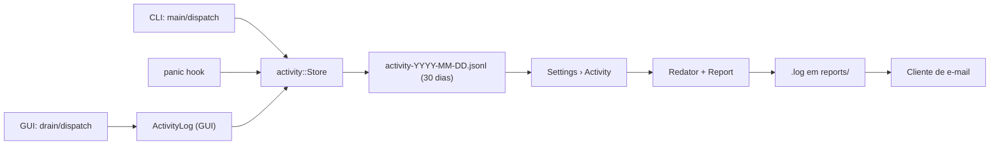
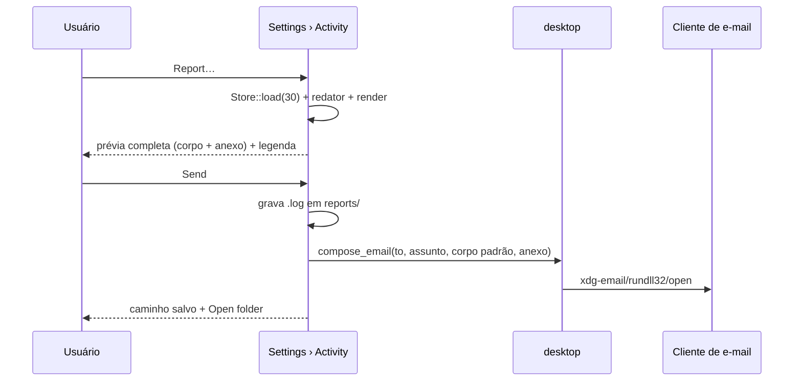

# Plano — Log de atividade e relato anonimizado

> **Status:** concluído
> **Criado em:** 2026-11-06
> **Atualizado em:** 2026-11-06
> **Complexidade:** alta
> **Depende de (outros planos):** nenhum

---

## 1. Visão Geral

Hoje o Mustel não guarda nada: erro de job vira toast (4–6 s), erro de CLI morre no terminal e
panic — sobretudo no `mustel-gui` do Windows, que não tem console — não deixa rastro. O objetivo é
uma **trilha de atividade estruturada**, gravada em disco, que responda "o que rodou e o que deu
erro" tanto na janela quanto no CLI, visível em **Settings › Activity** e exportável como um
relatório **anonimizado** que o usuário revisa, edita e envia por e-mail para
`support@mustelguild.dev`.

O valor é tornar o produto diagnosticável pelo próprio dono: "deu erro ontem" deixa de ser
indiagnosticável, e um crash passa a ter uma linha com mensagem e backtrace.

---

## 2. Escopo

**Inclui:**
- Módulo de atividade no núcleo: entrada estruturada (JSONL), arquivos diários, retenção de 30
  dias, carga dos 30 dias no arranque, poda e formatação UTC sem dependência de data.
- Instrumentação dos jobs da GUI, dos comandos do CLI, do ciclo do app e de panics.
- Aba **Settings › Activity**: tabela, filtro `All`/`Errors`, detalhe da entrada, estado vazio,
  `Refresh`, `Open folder` e `Report…`.
- Relatório: anonimização de nomes/hosts/bases/usuários/perfis/caminhos e remoção de SQL; legenda
  do que foi substituído **só na tela**; prévia **completa** (todo o corpo e todo o anexo, sem
  truncamento) e **editável**; gravação de um `.log`; envio pelo cliente de e-mail (anexo em melhor
  esforço).
- Link `support@mustelguild.dev` no About.
- Manifesto, documentação e isolamento dos testes.

**Exclui explicitamente:**
- Enviar e-mail por SMTP, subir para servidor ou qualquer envio automático — o e-mail é composto
  no cliente do usuário, depois de uma prévia explícita.
- Anexo **garantido** em todos os SOs: `mailto:` não anexa de forma portátil (ver D7). O `.log` é
  sempre salvo; o anexo é melhor esforço.
- Detectar kill abrupto/queda de energia via pareamento `start`/`finish` dentro de um job.
- Logar SQL no relatório exportado (nunca); o log local guarda apenas uma prévia curta.
- Rotação por tamanho/compressão, criptografia do log local, níveis de log de terceiros.
- Poda automática de `reports/`: os relatórios salvos ficam até o usuário apagá-los.
- Um relatório por entrada: nesta versão o relatório é sempre o log retido inteiro (o filtro da
  tabela não altera o relatório).

---

## 3. Decisões

| #  | Decisão | Escolha | Razão |
|----|---------|---------|-------|
| D1 | Destino do e-mail | `support@mustelguild.dev` | decisão do dono |
| D2 | Retenção | **30 dias**, um arquivo JSONL por dia | decisão do dono; poda simples e previsível |
| D3 | Formato | JSONL estruturado, um evento por linha | exibir na tabela, reler no arranque, anonimizar por campo e testar |
| D4 | Local do log | pasta de **estado** (`dirs::state_dir`, fallback `data_local_dir`) + `MUSTEL_LOG_DIR` | log não é configuração; o override isola testes |
| D5 | Timestamps | UTC, `YYYY-MM-DD HH:MM:SS`, com rótulo "UTC" na UI | reusa `civil_from_days`; sem `chrono`; consistente com o CSV |
| D6 | Escopo | jobs da GUI + comandos do CLI + ciclo do app + panic | decisão do dono (Q1) |
| D7 | Anexo | melhor esforço: Linux `xdg-email --attach`; Windows/macOS `mailto` com `attach=` + arquivo salvo | `mailto:` não anexa de forma portátil |
| D8 | SQL | prévia de 200 caracteres, uma linha, **só no log local**; nunca no relatório | decisão do dono (Q2); diagnosticar sem vazar |
| D9 | Prévia | mostra **todo** o conteúdo que será enviado — corpo padrão e anexo —, com modo de **leitura** e modo de **edição**, mais a legenda das substituições (legenda só na tela) | decisão do dono (Q3): ver tudo antes de enviar |
| D10 | Envio | nunca automático; só depois de `Send` | privacidade |
| D11 | `tracing` | não usar; o log é o arquivo de atividade | o dado precisa ser tipado e relido pela UI; atualizar AGENTS/D11 |
| D12 | Limites | **sem truncamento**: o relatório é o log retido inteiro (30 dias); a tabela é virtualizada; não há teto artificial de tamanho | ver tudo o que será enviado (Q3) |
| D13 | Sem `start`/`finish` por job | só eventos concluídos + `app.start`/`app.stop` + panic | decisão do dono (Q4); hard kill não teria registro mesmo |
| D14 | Comandos externos | `Vec<String>`, nunca shell | convenção do projeto (`unsafe` proibido, sem interpolação) |
| D15 | Corpo do e-mail | mensagem padrão com **versão do Mustel e SO/arquitetura** + o anexo `.log`; exibida na prévia e editável se o usuário quiser acrescentar contexto | decisão do dono (Q5) |
| D16 | Fonte do relatório | carregado do `Store` (30 dias) ao abrir, não do conjunto exibido na tabela | o relatório tem de ser completo, mesmo que a tabela role |

---

## 4. Arquitetura / Design



### Tipos / arquivos novos

- `crates/mustel-core/src/datetime.rs` — `civil_from_days` (movida), `format_utc`, `format_utc_compact`, `day_key`.
- `crates/mustel-core/src/activity/mod.rs` — docs e re-exports.
- `crates/mustel-core/src/activity/entry.rs` — `Entry`, `Area`, `Status`, serde e rótulos de exibição.
- `crates/mustel-core/src/activity/paths.rs` — `log_dir`, `log_dir_with`, `reports_dir`, `LOG_DIR_ENV`.
- `crates/mustel-core/src/activity/store.rs` — `Store { dir }`: `append`, `load`, `prune`, `file_for`.
- `crates/mustel-core/src/activity/redact.rs` — `Context`, `Redactor`, `Replacement`, regras.
- `crates/mustel-core/src/activity/report.rs` — `render` → `Report { text, legend, … }`.
- `crates/mustel-core/src/activity/crash.rs` — hook de panic.
- `crates/mustel-gui/src/activity_log.rs` — `Log` (store + entradas dos 30 dias) e `entry_for(&JobResult)`.
- `crates/mustel-gui/src/screens/activity.rs` — painel da categoria e modal do relatório (`Preview`/`Edit`).

### Mudanças em tipos existentes

- `crates/mustel-core/src/lib.rs` — `pub mod activity; pub mod datetime;`.
- `crates/mustel-core/src/postgres/value.rs` — passa a reexportar `civil_from_days` (mantém o caminho público).
- `crates/mustel-core/src/query/csv_writer.rs` — usa `crate::datetime::civil_from_days`.
- `crates/mustel-core/Cargo.toml` — `regex` já é dependência direta; nada a acrescentar.
- `crates/mustel-gui/src/app.rs` — campo `activity: activity_log::Log`; grava ciclo e resultados de job.
- `crates/mustel-gui/src/lib.rs` — `run()` instala o hook, poda e grava `app.start`/`app.stop`.
- `crates/mustel-gui/src/screens/settings.rs` — `Category::Activity`, `ALL` com 5, assinatura de `ui`
  recebendo o contexto.
- `crates/mustel-gui/src/screens/mod.rs` — `pub mod activity;`.
- `crates/mustel-gui/src/desktop.rs` — comandos de e-mail por SO e `compose_email`.
- `crates/mustel-gui/src/about.rs` — link de suporte.
- `crates/mustel/src/main.rs` — inicializa, poda, instala hook e grava o comando.
- `crates/mustel/src/cli.rs` — `activity_label()`.
- `crates/mustel/tests/support/mod.rs`, `cli_tree.rs`, `crates/mustel-testkit/src/bin/oracle-compare.rs`
  — `MUSTEL_LOG_DIR` em sandbox.

### Modelo de entrada

```rust
pub struct Entry {
    pub at_ms: u64,                 // UTC
    pub area: Area,                // App | Query | Database | Connections | Settings | Ai | Selector
    pub op: String,                // id estável: "query.run", "connection.test", "ai.test", …
    pub status: Status,            // Ok | Error | Cancelled | Info
    pub target: Option<String>,    // servidor, perfil, "servidor/base"
    pub detail: Option<String>,    // "42 rows", "3 databases"
    pub error: Option<String>,
    pub sql: Option<String>,       // só local; o relatório descarta
    pub duration_ms: Option<u64>,
}
```

Arquivo: `<log_dir>/activity-YYYY-MM-DD.jsonl`, uma linha por evento. `append` abre em modo
append a cada escrita (sem handle preso, seguro para o hook). `load(30, agora)` lê os arquivos do
período, ignora linhas malformadas e devolve em ordem cronológica. `prune(30, agora)` apaga
arquivos fora da janela. Relatórios: `<state>/Mustel/reports/mustel-report-YYYYMMDD-HHMMSS.log`.

### Anonimização

1. Substitui literais conhecidos (mais longos primeiro): nome/host/`host:porta`/usuário de cada
   servidor, nome/id de cada perfil, bases citadas nos `target`s, home e diretório de config.
2. Remove o campo `sql`.
3. Passa regex no texto livre: aspas (`"…"`), URLs/connection strings, e-mails, IPv4/IPv6,
   caminhos absolutos (drive Windows, `/…`, `~`).
4. Tokens estáveis: `server-1`, `host-1`, `user-1`, `profile-1`, `db-1`, `<home>`, `<config>`,
   `<path>`.
5. A legenda (`Replacement { what, from, to }`) é exibida **só na tela** e nunca entra no texto do
   relatório.

Teste de aceitação: um corpus de erros "sujos" (senha, IP, host, path, e-mail, tabela entre aspas,
connection string) não deixa nenhum original no texto gerado.

### Relatório

Cabeçalho (versão, SO/arch, gerado em UTC, período, contagem), tabela cronológica e uma seção
`ERRORS` com as mensagens completas. **Sem truncamento**: o texto contém todas as entradas retidas
nos 30 dias. A tabela da aba é virtualizada (`TableBuilder`), então rolar milhares de linhas não
custa; o relatório é montado a partir do `Store` no momento em que o modal abre (D16).

### Fluxo de envio



O **corpo** é uma mensagem padrão curta (versão do Mustel + SO/arquitetura + aviso de anexo), então
não há risco de estourar o limite do `mailto:`. O **anexo** é o `.log` completo — o mesmo texto da
prévia, exatamente como o usuário o editou. A legenda da anonimização aparece no modal, marcada
como "não enviada".

---

## 5. Tarefas

### Fase 1 — Núcleo

- [x] **T1** — Extrair `civil_from_days` para `datetime.rs` e criar `format_utc`, `format_utc_compact` e `day_key`.
  - Depende de: —
  - Paralelizável com: —
  - Concluído quando: testes de ano bissexto/época passam, `postgres::value::civil_from_days` continua acessível (reexport) e `csv_writer` compila.
  - Arquivos: `crates/mustel-core/src/datetime.rs`, `crates/mustel-core/src/lib.rs`, `crates/mustel-core/src/postgres/value.rs`, `crates/mustel-core/src/query/csv_writer.rs`

- [x] **T2** — Criar `activity::{entry,paths,store}`: `Entry` serde, `LOG_DIR_ENV`, `Store` com `append`, `load(30)` e `prune(30)`.
  - Depende de: T1
  - Paralelizável com: —
  - Concluído quando: ida-e-volta JSONL, linha malformada ignorada, janela de 30 dias respeitada, poda testada, `log_dir_with` testada sem tocar o ambiente.
  - Arquivos: `crates/mustel-core/src/activity/{mod,entry,paths,store}.rs`, `crates/mustel-core/src/lib.rs`, `crates/mustel-core/Cargo.toml`

- [x] **T3** — Criar `activity::redact`: `Context`, `Redactor`, `Replacement`, regras e legenda.
  - Depende de: T2
  - Paralelizável com: —
  - Concluído quando: o corpus "sujo" sai sem nenhum original; tokens são estáveis e determinísticos; a legenda não vaza para o texto.
  - Arquivos: `crates/mustel-core/src/activity/redact.rs`, `crates/mustel-core/src/activity/mod.rs`

- [x] **T4** — Criar `activity::report`: `render` com cabeçalho, tabela, seção de erros e **sem truncamento**.
  - Depende de: T2, T3
  - Paralelizável com: —
  - Concluído quando: o texto contém **todas** as entradas recebidas; não contém SQL nem nomes originais; contagens corretas; ordem cronológica.
  - Arquivos: `crates/mustel-core/src/activity/report.rs`, `crates/mustel-core/src/activity/mod.rs`

### Fase 2 — Instrumentação

- [x] **T5** — Hook de panic em `activity::crash`, com guarda contra recursão e chamada ao hook anterior.
  - Depende de: T2
  - Paralelizável com: T6
  - Concluído quando: panic numa thread de teste grava `app.panic` com mensagem e backtrace; um panic do próprio hook não recursa.
  - Arquivos: `crates/mustel-core/src/activity/crash.rs`, `crates/mustel-core/src/activity/mod.rs`

- [x] **T6** — Criar `mustel-gui::activity_log`: `Log` (store + entradas dos 30 dias) e `entry_for(&JobResult)`.
  - Depende de: T2
  - Paralelizável com: T5
  - Concluído quando: todos os `JobResult` mapeiam para a entrada certa (tabela de teste), a carga traz os 30 dias completos e um erro de disco vira `error()`.
  - Arquivos: `crates/mustel-gui/src/activity_log.rs`, `crates/mustel-gui/src/lib.rs`

- [x] **T7** — Ligar o log no `App`: `config.error` na abertura, cada resultado no `drain`, e `app.start`/`app.stop` no `run`.
  - Depende de: T5, T6
  - Paralelizável com: T8
  - Concluído quando: abrir a janela grava `app.start`; rodar um teste de conexão grava `connection.test`; fechar grava `app.stop`.
  - Arquivos: `crates/mustel-gui/src/app.rs`, `crates/mustel-gui/src/lib.rs`

- [x] **T8** — Instrumentar o CLI: `activity_label()` em `cli.rs` e registro em `main.rs` (inclusive erro de parse), silencioso.
  - Depende de: T2, T5
  - Paralelizável com: T7
  - Concluído quando: um comando grava uma linha; `--help`/`--version` não gravam; stdout/stderr não mudam.
  - Arquivos: `crates/mustel/src/main.rs`, `crates/mustel/src/cli.rs`

- [x] **T9** — Isolar os testes: `MUSTEL_LOG_DIR` em todo harness que executa o binário.
  - Depende de: T8
  - Paralelizável com: T10
  - Concluído quando: `cargo test` não cria nada em `~/.local/state`; `contract_replay` segue com as mesmas falhas conhecidas.
  - Arquivos: `crates/mustel/tests/support/mod.rs`, `crates/mustel/tests/cli_tree.rs`, `crates/mustel-testkit/src/bin/oracle-compare.rs`

### Fase 3 — UI

- [x] **T10** — Comandos de e-mail em `desktop.rs`: `mailto_url`, `compose_email_command_for`, `compose_email`.
  - Depende de: —
  - Paralelizável com: T9, T11
  - Concluído quando: Linux monta `xdg-email --attach`; Windows usa `rundll32`; macOS usa `open`; tudo em `Vec<String>`; URL percent-encoded testada.
  - Arquivos: `crates/mustel-gui/src/desktop.rs`

- [x] **T11** — Criar `screens/activity.rs` e a categoria `Activity` em Settings.
  - Depende de: T6
  - Paralelizável com: T10
  - Concluído quando: tabela com Time/Area/Operation/Result/Target/Duration, filtro All/Errors, detalhe selecionado, estado vazio, `Refresh` (relê o disco e pega execuções do CLI) e `Open folder`; o teste de `Category::ALL` atualizado para 5.
  - Arquivos: `crates/mustel-gui/src/screens/activity.rs`, `crates/mustel-gui/src/screens/settings.rs`, `crates/mustel-gui/src/screens/mod.rs`

- [x] **T12** — Modal `Report…`: prévia **completa** (corpo padrão + anexo), corpo editável, anexo em modo leitura com `Edit` para alterar, legenda do que foi anonimizado, `Copy`, `Save`, `Send`, `Cancel`.
  - Depende de: T4, T10, T11
  - Paralelizável com: T13
  - Concluído quando: a prévia mostra todo o conteúdo enviado, sem truncamento; a legenda aparece marcada como "não enviada"; editar o corpo ou o log muda exatamente o que vai no e-mail e no `.log`; `Send` grava o arquivo em `reports/` e abre o cliente com o corpo (versão + SO) e anexo em melhor esforço; erro vira dica na tela.
  - Arquivos: `crates/mustel-gui/src/screens/activity.rs`, `crates/mustel-gui/src/desktop.rs`

- [x] **T13** — Link `support@mustelguild.dev` no About, com teste do `OpenUrl`.
  - Depende de: —
  - Paralelizável com: T12
  - Concluído quando: o link aparece e emite `mailto:support@mustelguild.dev`.
  - Arquivos: `crates/mustel-gui/src/about.rs`

### Fase 4 — Contrato e documentação

- [x] **T14** — Linhas `IF-265` (log), `IF-266` (aba Activity) e `IF-267` (relatório/e-mail) no manifesto, com marcadores `CONTRACT:` nos testes.
  - Depende de: T7, T8, T12
  - Paralelizável com: T15
  - Concluído quando: `cargo test -p mustel --test contract_manifest` passa.
  - Arquivos: `docs/contrato-de-interface.md`, testes citados

- [x] **T15** — Documentação: referência do log e explicação de privacidade; links no `docs/README.md`; ajustar AGENTS/D11 (o log não é `tracing`).
  - Depende de: T12
  - Paralelizável com: T14
  - Concluído quando: `documentation_links_resolve` passa e as páginas descrevem formato, caminho, retenção e limites do anexo.
  - Arquivos: `docs/reference/activity-log.md`, `docs/explanation/log-e-privacidade.md`, `docs/README.md`, `docs/explanation/decisoes.md`, `AGENTS.md`

- [x] **T16** — Verificação final e smoke na janela.
  - Depende de: T1–T15
  - Paralelizável com: —
  - Concluído quando: a seção 6 passa por inteiro e as capturas temporárias são apagadas.
  - Arquivos: —

---

## 6. Estratégia de Verificação

- **Formatação:** `cargo fmt --all --check`
- **Lint:** `cargo clippy --workspace --all-targets --all-features -- -D warnings`
- **Testes focados:**
  - `cargo test -p mustel-core activity`
  - `cargo test -p mustel-core datetime`
  - `cargo test -p mustel-gui`
  - `cargo test -p mustel --test contract_manifest`
- **Gate:** `cargo test --workspace --no-fail-fast`
  - No Linux, os alvos `cli_tree` (snapshots com `mustel.exe`) e `contract_replay` (pgpass CRLF)
    já falham antes deste plano: confirmar que são **exatamente** esses e não regressão.
- **Contrato do CLI:** `cargo run -p mustel -- --help` inalterado; os snapshots de texto seguem.
- **Isolamento:** rodar os testes com `HOME`/XDG temporários e confirmar que nada é criado em
  `~/.local/state/Mustel` nem em `%LOCALAPPDATA%`.
- **Grep de resíduos:**
  - `grep -rn "support@mustelguild.dev" crates` — só as constantes e o About.
  - `grep -rn "unwrap()\|expect(" crates/mustel-core/src/activity crates/mustel-gui/src/screens/activity.rs`
    — nenhum em caminho de execução.
  - `grep -rn "Command::new" crates/mustel-gui/src/desktop.rs` — sem `sh`/`cmd`.
- **Smoke manual (janela):**
  1. abrir `cargo run -p mustel -- gui`;
  2. gerar erro (testar um servidor inválido);
  3. Settings › Activity: conferir a linha e o detalhe;
  4. `Report…`: conferir que a prévia mostra **o corpo e o log inteiro**, que não há nome/IP/caminho/SQL,
     que a legenda mostra as substituições e que o conteúdo é editável;
  5. `Send`: conferir o `.log` em `reports/`, o cliente aberto e o anexo quando o cliente permitir;
  6. fechar e reabrir: a entrada continua lá; apagar as capturas de `target/shots/`.
- **Privacidade:** um teste dedicado alimenta o relatório com um corpus de erros sujos e falha se
  qualquer original aparecer.
- **Completude da prévia:** um teste com N entradas sintéticas confirma que o texto do relatório
  contém **todas** elas (sem truncamento); outro confirma que o `.log` gravado é byte a byte o
  texto da prévia editada e que o corpo exibido é o corpo composto (versão + SO).

> O agente só marca o plano como `concluído` após **todas** as verificações passarem. Se algo
> falhar, registrar na seção 9 e corrigir antes de devolver.

---

## 7. Riscos e Mitigação

| Risco | Prob | Impacto | Mitigação |
|---|---|---|---|
| Vazamento de nome/host/SQL no relatório | média | alto | corpus de teste agressivo, legenda só na tela, prévia editável, nenhum envio automático |
| `mailto:` não anexar no Windows/macOS | alta | médio | sempre salvar o `.log`; mostrar o caminho e `Open folder`; `attach=` em melhor esforço; `xdg-email --attach` no Linux |
| Crescimento do log | média | baixo | arquivo diário + poda de 30 dias; a tabela é virtualizada e o relatório é montado do disco uma vez por abertura |
| Testes sujando o log real | alta | médio | `MUSTEL_LOG_DIR` em todo harness; funções puras `*_with` nos testes |
| Escrita concorrente (GUI + CLI + hook) | baixa | baixo | append por escrita, linha curta, ignorar linha malformada |
| Recursão do hook de panic | baixa | alto | guarda atômica e hook anterior preservado |
| Travar a UI ao carregar 30 dias | baixa | médio | carga única no arranque, tabela virtualizada e modo de leitura da prévia (o `TextEdit` só no modo de edição) |
| Contrato do CLI quebrar com log | baixa | alto | log só em arquivo; verificação dos snapshots e do replay |

---

## 8. Questões em Aberto

Nenhuma. As cinco questões foram respondidas pelo dono e viraram decisões:

| Questão | Resposta | Onde está |
|---|---|---|
| Q1 — o CLI entra no log? | **Sim**, no nível de comando | D6 (T8/T9) |
| Q2 — guardar prévia de SQL no log local? | **Sim**, 200 caracteres, uma linha; nunca no relatório | D8 |
| Q3 — a prévia pode truncar? | **Não**: a prévia tem todo o conteúdo que será enviado (corpo + anexo) | D9, D12 |
| Q4 — `app.start`/`app.stop` no log? | **Sim**, sem pareamento por job | D13 |
| Q5 — corpo do e-mail? | Mensagem padrão com **versão + SO/arquitetura** + anexo | D15 |

---

## 9. Log de Execução

Append-only. O agente registra cada avanço relevante (início, conclusão, bloqueio, paralelização,
falhas). Mantém o "Atualizado em" sincronizado.

- `[2026-11-06]` Plano criado a partir da exploração; decisões D1–D14 registradas.
- `[2026-11-06]` Q1–Q5 respondidas. D6/D8/D13 confirmadas; D9/D12 reescritas para **proibir
truncamento** (a prévia é exatamente o que será enviado); D15 (corpo padrão com versão + SO) e
D16 (relatório lido do `Store`, não da tabela) acrescentadas; riscos de desempenho ajustados.
- `[2026-11-06]` Execução iniciada pelo mustel-apply.
- `[2026-11-06]` T1 concluída — `datetime.rs` com `civil_from_days` (reexportado em `postgres::value`), `format_utc`, `day_key` e `format_utc_compact`; 6 testes novos e os de `postgres::value` seguem verdes.
- `[2026-11-06]` T2 concluída — `activity::{entry,paths,store}` com JSONL diário, janela de 30 dias, poda e override `MUSTEL_LOG_DIR`; 15 testes.
- `[2026-11-06]` T3 concluída — `activity::redact` com literais (servidor/host/usuário/base/perfil/caminhos) e padrões (aspas, URL, e-mail, IP, caminhos); legenda determinística só para a tela; 7 testes.
- `[2026-11-06]` T4 concluída — `activity::report` sem truncamento, com cabeçalho, tabela, seção `ERRORS` e contagens; 6 testes (inclui 500 entradas completas).
- `[2026-11-06]` T5 concluída — hook de panic em `activity::crash` (mensagem + localização + backtrace, guarda de recursão e hook anterior); teste com `catch_unwind`.
- `[2026-11-06]` T6 concluída — `activity_log::{Log, entry_for}` na GUI: ring em memória sobre o store, mapeamento de todos os `JobResult` e erro de disco exposto; 6 testes.
- `[2026-11-06]` T7 concluída — `App` grava `app.config`, a duração de cada job e cada resultado no `drain`; `run` instala o hook, poda e grava `app.start`/`app.stop`.
- `[2026-11-06]` T10 concluída — `desktop::{mailto_url, compose_email_command_for, compose_email}` (Linux `xdg-email --attach`, Windows `rundll32`, macOS `open`), com percent-encoding e testes por SO.
- `[2026-11-06]` T11 concluída — categoria `Activity` (5ª), tabela virtualizada, filtro All/Errors, detalhe, vazio, Refresh e Open folder; testes de UI com dois quadros.
- `[2026-11-06]` T12 concluída — modal `Report…` com corpo editável, anexo completo em leitura/edição, legenda local, Copy/Save/Send/Cancel; `.log` salvo é byte a byte a prévia; testes de completude e de anonimização.
- `[2026-11-06]` T8 concluída — CLI registra o comando (`activity_label` por área/operação/alvo), a duração e o erro; erro de parse também entra; `--help`/`--version` não; stdout/stderr inalterados.
- `[2026-11-06]` T9 concluída — `MUSTEL_LOG_DIR` em `support`, `cli_tree`, `settings_db_servers_*` e `oracle-compare`; o teste de isolamento confere a entrada de log dentro do sandbox.
- `[2026-11-06]` T13 concluída — About › Support como link `mailto:support@mustelguild.dev`, com teste do `OpenUrl`.
- `[2026-11-06]` T14 concluída — `IF-265`, `IF-266` e `IF-267` no manifesto, com marcadores e testes; `contract_manifest` verde.
- `[2026-11-06]` T15 concluída — `docs/reference/activity-log.md`, `docs/explanation/log-e-privacidade.md`, links no README, Settings atualizado, AGENTS/D11 sem `tracing`; `documentation_links_resolve` verde.
- `[2026-11-06]` T16 concluída — `fmt --check`, `clippy -D warnings` e `cargo test --workspace --no-fail-fast` (só os 2 alvos já conhecidos: snapshots com `mustel.exe` e pgpass CRLF). Smoke na janela: aba Activity com entradas, modal do relatório com corpo + anexo + legenda, rodapé fixo; `.log` verificado e artefatos de teste apagados.
- `[2026-11-06]` Plano concluído — todas as verificações da Seção 6 passaram (ressalvadas as duas falhas pré-existentes do Linux).
