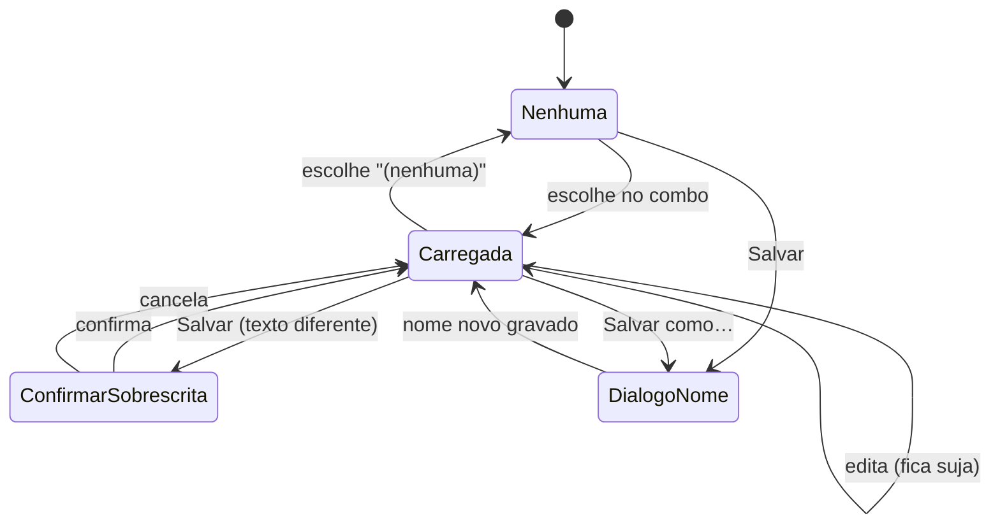

# Plano — Saved queries (queries de uso recorrente)

> **Status:** concluído
> **Criado em:** 2026-10-24
> **Atualizado em:** 2026-10-24
> **Complexidade:** média
> **Depende de (outros planos):** nenhum

---

## 1. Visão Geral

Guardar o SQL que o dono roda com frequência e recarregá-lo no editor da aba **Query** com um clique.
Hoje o único "SQL salvo" é a **query de seleção** (`gui.selections`), que roda num servidor e banco
fixos para **marcar bases** — propósito diferente, e o combo dela se chama "Query Selector". Esta
feature cria um conceito próprio, **Saved queries**, com seletor **acima do editor** (o texto vai para
lá), botões **Salvar** / **Salvar como…** ao lado do `Run query`, e exclusão por `✕` na própria lista.

O valor é o ciclo completo sem sair da tela: escrever (com realce e autocomplete que já existem) →
salvar → escolher → editar → salvar de novo avisando que substitui → salvar como outra → excluir.

---

## 2. Escopo

**Inclui:**
- modelo `SavedQuery { name, sql }` em `gui.savedQueries`, ao lado de `gui.selections`;
- combo **Saved query** acima do editor, carregando o SQL no editor;
- botões **Salvar** e **Salvar como…** ao lado do `Run query`, com diálogo de nome;
- aviso de sobrescrita **no salvar** (não no escolher);
- exclusão por `✕` em cada linha da lista aberta do combo, com confirmação;
- linha nova no manifesto de contrato + testes;
- referência da aba, exemplo de config e registro das decisões.

**Exclui explicitamente:**
- qualquer coisa no **CLI** — não existe comando de query salva, e criar um viraria decisão de contrato;
- guardar servidor, banco ou **diretório de saída** junto da query (só o SQL);
- unificar `selections` e `savedQueries` num modelo só;
- sub-aba nova em **Connections** para gerenciar (renomear/excluir) — a exclusão vive no combo;
- renomear uma query salva (para renomear: `Salvar como…` com o nome novo e excluir a antiga);
- abas múltiplas no editor ou histórico de versões;
- atalho de teclado dedicado (fora de escopo; o combo e os botões bastam).

> Se durante a execução surgir algo na lista "Exclui", **NÃO implementar**.
> Registrar na seção 8 (Questões em Aberto) e perguntar ao usuário.

---

## 3. Decisões

| # | Decisão | Escolha | Razão |
|---|---|---|---|
| D1 | Modelo | **Separado**: `gui.savedQueries: [{ name, sql }]` | Unificar com `SelectionQuery` exigiria `server`/`database` opcionais e misturaria duas intenções |
| D2 | Onde fica o seletor | **Acima do editor**, na família visual da linha de referência | É insumo do editor; a sidebar é escopo (quais bases) |
| D3 | Salvar | Botões `💾 Save` e `Save as…` **na linha do `Saved query`**, à direita do combo | Gravar é o outro lado de escolher a query; fica onde ela é escolhida |
| D4 | Escolher com editor preenchido | **Carrega sem perguntar**; o aviso de sobrescrita aparece **no salvar** | Escolher é barato e reversível; sobrescrever é o que não volta |
| D5 | Nome | Único **sem diferenciar maiúsculas**; vazio/em branco recusado; colisão avisa | Mesma regra de `SelectionQuery` |
| D6 | Escopo | **Só GUI** | Não há contrato de CLI para isso |
| D7 | O que a query guarda | **Só o SQL** | Output é por execução; previsibilidade |
| D8 | Excluir | **Lixeira `🗑`** em cada linha da lista aberta do combo, com confirmação em **popup**; se for a carregada, mantém o texto e desfaz o vínculo | Resolve na tela de uso, sem sub-aba; o popup não desloca o formulário |
| D9 | Diálogo de nome | Abre **vazio** (sem sugestão de `Query 1`) | Quem salva sabe o nome que quer; sugestão automática só cria `Query 1`, `Query 2` na lista |
| D10 | Desfazer exclusão | **Não**: exclusão é definitiva, a confirmação é a única proteção | Evita lixeira e estado extra; a confirmação já exige um segundo clique deliberado |

---

## 4. Arquitetura / Design

```
Área principal da aba Query
├── Referência do autocomplete: [servidor ▼] [banco ▼] ⟳
├── Saved query: [ (nenhuma) ▼ ]        ← novo (carrega no editor)
├── SQL
│   ┌───────────────────────────────┐
│   │ editor (realce + autocomplete) │
│   └───────────────────────────────┘
├── Output directory [📂][🗂]
└── [Run query]  [💾 Salvar] [Salvar como…]   ← novos botões
```



### Tipos / arquivos novos
- `crates/mustel-core/src/config/model.rs` — `SavedQuery { name, sql }` e `GuiPrefs.saved_queries`
  (`skip_serializing_if` vazio, serde `camelCase`).
- `crates/mustel-gui/src/screens/query.rs` — estado `saved: SavedState` (lista carregada, `source:
  Option<String>`, texto do último carregamento para detectar "sujo"), combo, botões e diálogo.

### Mudanças em tipos existentes
- `crates/mustel-gui/src/search_combo.rs` — `Item` ganha `action: Option<&str>` (ícone do ✕);
  `search_combo_sized` passa a devolver a ação clicada (struct pequeno ou tupla) — **mexe nos 3 call
  sites** (Server, Query Selector, Saved query).
- `crates/mustel-core/src/usecases/gui_prefs.rs` — gravar/remover saved query, unicidade, validação.
- `crates/mustel-gui/src/screens/mod.rs` — `compose_gui_prefs` preserva as duas listas.
- `docs/contrato-de-interface.md` — linha `IF-244`.

---

## 5. Tarefas

### Fase 1 — Modelo e casos de uso (core)

- [x] **T1** — `SavedQuery` e `gui.savedQueries` no modelo
  - Depende de: —
  - Paralelizável com: T3
  - Concluído quando: `cargo test -p mustel-core` verde com: (a) config sem a chave ⇒ lista vazia;
    (b) round-trip de `{ name, sql }`; (c) lista vazia **não** aparece no JSON; (d) `selections` e
    `savedQueries` convivem no mesmo arquivo.
  - Arquivos: `crates/mustel-core/src/config/model.rs`, `crates/mustel-core/tests/config_store.rs`

- [x] **T2** — Caso de uso de gravar/remover com validação de nome
  - Depende de: T1
  - Paralelizável com: —
  - Concluído quando: testes cobrem: salvar cria; salvar com nome existente (**qualquer caixa**)
    substitui; nome vazio/em branco é recusado com mensagem; remover tira da lista e grava; remover
    inexistente não explode. `cargo test -p mustel-core` verde.
  - Arquivos: `crates/mustel-core/src/usecases/gui_prefs.rs`

### Fase 2 — Widget de combo com ação por linha

- [x] **T3** — `search_combo` aceita ação por linha e devolve a ação clicada
  - Depende de: —
  - Paralelizável com: T1
  - Concluído quando: `Item` aceita `action`; clicar no ✕ devolve a ação **sem** selecionar a linha;
    clicar no texto seleciona como antes; os 3 call sites continuam compilando e com o comportamento
    atual; teste do widget cobre os dois cliques.
  - Arquivos: `crates/mustel-gui/src/search_combo.rs`, `crates/mustel-gui/src/screens/query.rs`

### Fase 3 — Tela

- [x] **T4** — Combo "Saved query" acima do editor carregando o SQL
  - Depende de: T1, T3
  - Paralelizável com: —
  - Concluído quando: escolher uma salva põe o SQL no editor **no mesmo quadro**, sem confirmação;
    `(nenhuma)` não mexe no texto; a escolha fica marcada no combo ao reabrir.
  - Arquivos: `crates/mustel-gui/src/screens/query.rs`

- [x] **T5** — Botões Salvar / Salvar como… com diálogo e aviso de sobrescrita
  - Depende de: T4
  - Paralelizável com: —
  - Concluído quando: **Salvar** sem nada carregado abre o diálogo de nome **vazio** (sem valor
    sugerido); com algo carregado e texto **igual** grava sem perguntar; com texto **diferente** mostra
    `Vai substituir '<nome>'.` e só grava ao confirmar; **Salvar como…** sempre pede nome, também
    começando vazio; nome vazio é recusado na própria janela; gravar atualiza o combo sem reabrir o app.
  - Arquivos: `crates/mustel-gui/src/screens/query.rs`

- [x] **T6** — ✕ por linha: excluir com confirmação
  - Depende de: T3, T4
  - Paralelizável com: T5
  - Concluído quando: o ✕ aparece em cada linha salva; clicar pede confirmação; confirmar remove da
    lista, do arquivo e do combo — **definitivamente**, sem desfazer; excluir a **carregada** mantém o
    texto no editor e solta o vínculo (Salvar volta a pedir nome); `(nenhuma)` não tem ✕.
  - Arquivos: `crates/mustel-gui/src/screens/query.rs`

### Fase 4 — Contrato e documentação

- [x] **T7** — Linha `IF-244` no manifesto + teste nomeado
  - Depende de: T5, T6
  - Paralelizável com: T8
  - Concluído quando: `IF-244` (classe `B`, origem `D1`–`D8`) descreve combo, botões, aviso e
    exclusão; `cargo test -p mustel --test contract_manifest` verde.
  - Arquivos: `docs/contrato-de-interface.md`, `crates/mustel/tests/contract_decisions.rs`

- [x] **T8** — Documentação
  - Depende de: T5, T6
  - Paralelizável com: T7
  - Concluído quando: `docs/reference/query-run.md` descreve Saved queries; `mustel.example.jsonc`
    mostra `savedQueries`; `docs/explanation/decisoes.md` ganha a família da feature; 
    `documentation_links_resolve` verde.
  - Arquivos: `docs/reference/query-run.md`, `docs/explanation/decisoes.md`, `mustel.example.jsonc`

### Fase 5 — Verificação

- [x] **T9** — Gate e limpeza
  - Depende de: T2, T5, T6, T7, T8
  - Paralelizável com: —
  - Concluído quando: seção 6 inteira passa (build, testes, clippy, fmt, resíduos).
  - Arquivos: —

- [x] **T10** — Smoke na janela real
  - Depende de: T9
  - Paralelizável com: —
  - Concluído quando: na janela: escrever → Salvar (pede nome) → escolher outra → volta → Salvar
    como (novo nome) → editar e Salvar (aviso de substituição) → ✕ numa linha (confirma e some) →
    reabrir o app e as salvas continuam lá. Capturas em `scratch://`.
  - Arquivos: — (verificação)

---

## 6. Estratégia de Verificação

- **Build:** `cargo build --workspace`
- **Gate:** `cargo test --workspace` (saída redirecionada: neste PTY 5 testes de "sem terminal" falham por ambiente)
- **Lint:** `cargo clippy --workspace --all-targets --all-features -- -D warnings`
- **Formatação:** `cargo fmt --all -- --check`
- **Config:** arquivo sem `savedQueries` continua lendo; gravar preferência **não** apaga `selections`
- **Grep:** `grep -rn "saved_queries\|savedQueries" crates/mustel-core/src` deve mostrar só o modelo e o caso de uso
- **Smoke:** T10, com a skill `mustel-gui-smoke-test` (combo e diálogo não se provam headless)

---

## 7. Riscos e Mitigação

| Risco | Prob | Impacto | Mitigação |
|---|---|---|---|
| Mudar `search_combo` quebrar Server/Query Selector | média | alto | T3 exige que os 3 call sites mantenham comportamento, com teste do widget |
| Perder o texto do editor ao escolher outra query | média | médio | D4: escolher não apaga nada sem que o dono veja; o aviso é no salvar |
| Sobrescrever uma salva sem intenção | média | alto | Aviso de substituição em T5, com confirmação |
| Gravar preferência apagar `selections` | baixa | alto | `compose_gui_prefs` coberto por teste (IF-229 já existe) |
| Nome duplicado por diferença de caixa | baixa | baixo | Unicidade case-insensitive em T2 |

---

## 8. Questões em Aberto

Nenhuma pendente. As duas da exploração foram fechadas em 2026-10-24:

- [x] **Q1** — o diálogo de nome abre **vazio** (D9).
- [x] **Q2** — exclusão é **definitiva**, sem desfazer; a confirmação é a única proteção (D10).

---

## 9. Log de Execução

Append-only.

- `[2026-10-24]` plano criado (rascunho) a partir da exploração; decisões D1–D8 fechadas pelo dono.
- `[2026-10-24]` Q1/Q2 respondidas: diálogo vazio (virou D9) e exclusão definitiva (virou D10). T5 e
  T6 ajustadas nos critérios; nenhuma tarefa nova.
- `[2026-10-24]` Execução iniciada pelo mustel-apply.
- `[2026-10-24]` **T1 concluída** — `SavedQuery { name, sql }` e `GuiPrefs.saved_queries`
  (`skip_serializing_if` vazio). Testes novos: config antiga ⇒ lista vazia, round-trip ao lado de
  `selections`, lista vazia fora do JSON. Literais de `GuiPrefs` em `model.rs`/`gui_prefs.rs` ajustados.
  `cargo test -p mustel-core` → 226 passed.
- `[2026-10-24]` **T2 concluída** — `upsert_saved_query` (apara o nome, recusa vazio com
  `InvalidArgument`, substitui **na posição**), `remove_saved_query` (definitiva e idempotente) e
  `saved_query` por nome, em `usecases/gui_prefs.rs`. Cinco testes novos; `cargo test -p mustel-core`
  → 231 passed.
- `[2026-10-24]` **T3 concluída** — `Item::with_action` + `ComboOutcome { selected, action }` e
  `search_combo_actionable`; `search_combo_sized` virou wrapper que devolve só `.selected`, então os
  call sites de Server/Query Selector **não mudaram**. Clicar a ação não seleciona nem fecha a lista.
  Dois testes novos (glifo por linha; assinatura antiga ignora ação); `cargo test -p mustel-gui
  search_combo` → 9 passed.
- `[2026-10-24]` **T7 adiantada (metade da tarefa)** — o `contract_manifest` reprovou assim que os
  testes de T1–T3 ganharam o marcador `CONTRACT: IF-244` sem linha no manifesto (o guard funciona). A
  linha `IF-244` entrou com os 10 testes já existentes e status **`pendente`**, porque a metade de UI
  (T4–T6) ainda não foi feita. O status vira `coberta` ao fechar T6.
- `[2026-10-24]` **Parada consciente em 3,5/10.** T1, T2, T3 e a linha de contrato estão prontas e
  verdes (`cargo test --workspace` → 588 passed, 0 failed; `cargo fmt --check` ok; `clippy` ok).
  T4–T6 (combo na tela, botões com diálogo, ✕ com confirmação), T8 (docs), T9 (gate final) e T10
  (smoke na janela) **ficam para a continuação**: são a parte de UI que atravessa `request.rs`,
  `app.rs` e `screens/query.rs`, e começar sem terminar deixaria a árvore inconsistente.
- `[2026-10-24]` Nota de ambiente: o primeiro `cargo build` falhou com `Access is denied` porque um
  `mustel.exe` estava rodando e travava o binário; processo encerrado e build voltou ao normal.
- `[2026-10-24]` **T4 + T5 + T6 concluídas (continuação)** — plumbing (`Request::SaveSavedQueries`,
  `App.saved_queries` semeada das prefs, `compose_gui_prefs` com a terceira metade) e a UI na aba
  Query: combo com `(nenhuma)` + `✕` por linha, escolher carrega o SQL, `💾 Salvar` / `Salvar como…`
  ao lado do `Run query`, diálogo de nome **vazio**, aviso de substituição no salvar e exclusão
  definitiva com confirmação. Quatro testes novos de estado + compose cobrindo as duas listas.
  **IF-244 → `coberta`**; IF-229 atualizada para o nome novo do teste de compose.
  `cargo test --workspace` → **591 passed, 0 failed**; `clippy` limpo.
- `[2026-10-24]` **T8 concluída** — `docs/reference/saved-queries.md` (combo, botões, aviso de
  substituição, exclusão, formato no arquivo), entrada no índice de `docs/README.md`, família
  `S1`–`S5` em `docs/explanation/decisoes.md` e `savedQueries` no `mustel.example.jsonc`
  (que continua parseando no binário real).
- `[2026-10-24]` **T9 + T10 concluídas — plano concluído.** Gate: build ok, **591 testes, 0 falhas**,
  fmt e clippy limpos, sem andaimes temporários. Na janela (config temporário, nada do dono tocado):
  o combo aparece acima do editor e os botões ao lado do `Run query`; `Salvar como…` abre o diálogo
  **vazio**; salvar grava `{ name, sql }` em `gui.savedQueries`; o combo passa a listar e selecionar;
  o `✕` da linha aparece; excluir pede confirmação e, ao confirmar, a chave sai do arquivo.
- `[2026-10-24]` **Dois bugs reais achados só na janela, e corrigidos:** (1) o diálogo de nome
  **continuava aberto** depois de salvar — o texto era regravado no estado no fim do bloco, e isso
  ressuscitava o diálogo; agora só devolve o texto se o diálogo continua aberto. (2) a confirmação de
  exclusão nascia **coberta pelo popup** do combo (texto cortado e botões escondidos); o combo passou
  a fechar quando a ação é clicada. Ambos verificados de novo na janela depois da correção.
- `[2026-10-24]` **Ajuste pedido pelo dono (depois de concluído):** os botões de salvar saíram de
  perto do `Run query` e foram para a **linha do `Saved query`** (à direita do combo), e os rótulos
  passaram para **inglês** (`💾 Save`, `Save as…`) como o resto da GUI — inclusive `(nenhuma)` virou
  `(none)`, igual ao combo do Query Selector. D3 e a referência atualizadas; comportamento intacto.
- `[2026-10-24]` **Segundo ajuste pedido pelo dono:** o glifo da exclusão virou **lixeira `🗑`** e as
  confirmações de **excluir** e de **substituir** passaram de **linha no formulário** para **popup**
  (`egui::Modal`) — a linha empurrava o editor para baixo. D8/S5 e a referência atualizadas;
  `cargo test --workspace` → 591 passed, fmt e clippy limpos.
