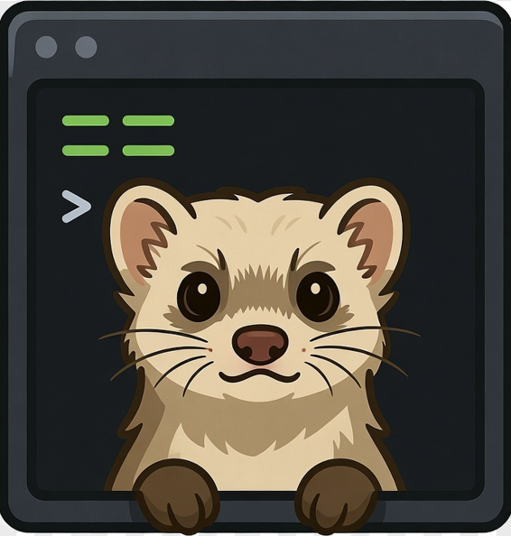

<div align="center">
  

  # Mustel

  Um único binário nativo para rodar SQL em vários servidores PostgreSQL, exportar CSV, fazer backup e
  restore — do terminal ou de uma janela.
</div>

---

[](https://ko-fi.com/K3K41AP4RO)
[](https://www.buymeacoffee.com/liphvf)

O Mustel é a reescrita em Rust de um CLI .NET que se chamava FurLab. Os três grupos do produto —
`query`, `database` e `settings` — estão migrados, e a interface gráfica vem no mesmo binário. A
implementação .NET foi removida do repositório; o comportamento observável dela está congelado como
**contrato de teste** em `oracle/baseline/`, e cada caso roda em `cargo test`.

## Descrição

O Mustel executa SQL em vários servidores PostgreSQL de uma vez, grava o resultado em CSV, faz backup e
restore com `pg_dump`/`pg_restore` e mantém o cadastro de servidores — do terminal (`mustel ...`) ou de
uma janela (`mustel gui`), sobre o **mesmo núcleo**.

## Instalação

Gere o pacote de release da plataforma atual:

```bash
# Windows
./publish.ps1
# Linux
./publish.sh
```

Cada um produz `packaging/mustel-<versão>-<alvo>/` (binário, `mustel.example.jsonc`, `LICENSE`,
`README.txt`), um arquivo compactado (`.zip` no Windows, `.tar.gz` no Unix) e o `.sha256` ao lado.
Copie o binário para um diretório do seu `PATH`.

**Alvos suportados**: `x86_64-pc-windows-msvc` e `x86_64-unknown-linux-gnu`.
macOS **não** é suportado por enquanto.

**Dependência de runtime (Linux)**: `libdbus-1.so.3` — `sudo apt install libdbus-1-3` no
Debian/Ubuntu. Abrir a janela exige também X11 ou Wayland com OpenGL; o CLI sozinho ainda carrega a
libdbus na partida.

> `cargo install mustel` e o pacote do winget (`Mustel.CLI`) **ainda não estão publicados** — ver
> [`MustelPlans/release-pendencias.md`](MustelPlans/release-pendencias.md). Até lá, use o arquivo de
> release.

## Comandos

| Grupo | Comandos |
|---|---|
| `query` | `query run` (descoberta, paralelismo, export CSV, progresso ao vivo) |
| `database` | `database backup`, `database restore`, `database pgpass add/list/remove` |
| `settings` | `settings db-servers ls/add/rm/test/set-password` |
| `gui` | `mustel gui` — cadastro de servidores e `query run` numa janela |

### Exemplos

```bash
# Rodar um arquivo SQL nos servidores selecionados
mustel query run -i query.sql

# Consulta inline, todos os bancos do servidor
mustel query run -c "select count(*) from pedidos" --all --exclude postgres

# Cadastro de servidores
mustel settings db-servers add -n dev -H localhost -p 5432 -U postgres -d mydb
mustel settings db-servers set-password dev
mustel settings db-servers ls

# Backup e restore
mustel database backup mydb -o ./backups
mustel database restore mydb ./backups/mydb.dump

# pgpass.conf
mustel database pgpass add mydb --host localhost --username postgres
```

## Configuração

`%APPDATA%\Mustel\mustel.jsonc` no Windows, `$XDG_CONFIG_HOME/Mustel/mustel.jsonc`
(normalmente `~/.config/Mustel/mustel.jsonc`) no Linux. JSONC, com comentários. As senhas **não**
ficam no arquivo: vão para o cofre do SO (Windows Credential Manager / Secret Service), com a chave
igual ao nome do servidor.

Comece por [`mustel.example.jsonc`](mustel.example.jsonc).

## Como rodar a partir do código

```bash
cargo run -p mustel -- --help
cargo run -p mustel                  # sem subcomando: abre a janela
cargo run -p mustel -- gui           # o mesmo, explícito
cargo run -p mustel --no-default-features -- --help   # só CLI, sem egui no build
```

Rodar `mustel` **sem subcomando** abre a GUI quando existe terminal interativo (digitando, ou com
duplo-clique no binário). Sem terminal — script, pipe, CI — ele imprime a ajuda e sai 0, então nada
quebra para automação.

A GUI vive no mesmo binário, então todo comando paga o custo de partida dela (~55 ms). Se você só
scripta, construa com `--no-default-features` para ter o CLI enxuto (7,8 ms em vez de 63 ms).

## O contrato

O comportamento é preso por duas camadas dentro de `cargo test`:

- `oracle/baseline/*.json` — 47 capturas congeladas do binário antigo, reexecutadas contra o `mustel`
  (`contract_replay`);
- [`docs/contrato-de-interface.md`](docs/contrato-de-interface.md) — uma linha por decisão de
  interface, cada uma apontando o teste que a prova (`contract_manifest`).

O gate é `cargo test --workspace`. O `oracle-compare` continua como diagnóstico que mostra as
diferenças de texto N4 caso a caso.

## Documentação

Comece por [`docs/README.md`](docs/README.md), organizada em quatro quadrantes (tutorial, how-to,
referência, explicação).

## Contribuição

Contribuições são bem-vindas:

1. Faça um fork do repositório
2. Crie uma branch (`git checkout -b feature/amazing-feature`)
3. Faça o commit (`git commit -m 'Add amazing feature'`)
4. Faça o push (`git push origin feature/amazing-feature`)
5. Abra um Pull Request

O guia do repositório para quem contribui e para agentes é o [`AGENTS.md`](AGENTS.md). Antes de abrir
um PR, rode `cargo fmt`, `cargo clippy -- -D warnings` e `cargo test --workspace`.

## Licença

Este projeto é licenciado sob a **GNU General Public License v3.0** (`GPL-3.0-only`) — ver o arquivo
[LICENSE](./LICENSE) para detalhes. Os manifestos do Cargo declaram `license = "GPL-3.0-only"`.

---

🇺🇸 Inglês (padrão): [README.md](./README.md)  
🇧🇷 Português (este arquivo)
